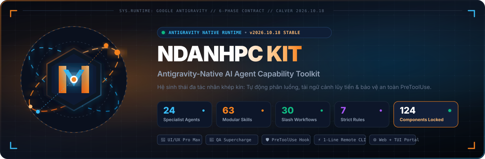
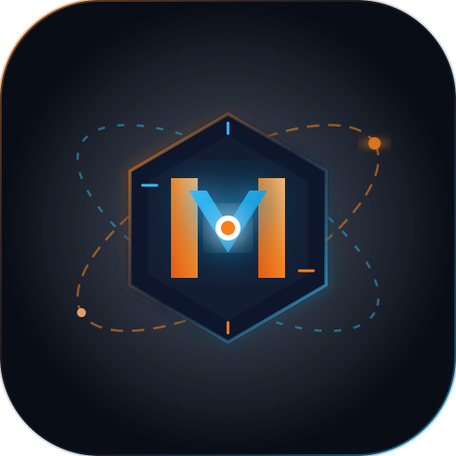

<p align="center">
  <a href="https://github.com/ducanhfw4802/ndanhpc-kit">
    
  </a>
</p>

<p align="center">
  
  <br>
  <a href="CHANGELOG.md"></a>
  <a href=".agents/antigravity.json"></a>
  <a href="#-25-specialist-agents"></a>
  <a href="#-67-modular-skills"></a>
  <a href="#-32-workflows--slash-commands"></a>
  <a href=".agents/manifest.lock.json"></a>
</p>

<p align="center">
  <b>Hệ sinh thái 131 thành phần đa tác nhân (Multi-Agent) chuyên sâu, thông minh và an toàn dành riêng cho Google Antigravity.</b>
</p>

---

## 🌟 Mới Nhất: Release v2026.10.19 (AI Engineering, GenAI RAG, DevOps & Component Scaffolding)

Bản phát hành **v2026.10.19** mở rộng đột phá với Specialist Agent chuyên sâu AI Engineering, 3 Modular Skills mới, công cụ tự động tạo component và đạt mốc 131 thành phần toàn vẹn:

- 🤖 **Agent Chuyên Biệt `ai-engineer` & Kỹ Năng `ai-rag-patterns`**: Bổ sung Specialist Agent thứ 25 (`ai-engineer.md`) cùng kỹ năng RAG chuyên sâu (pgvector, Qdrant, Pinecone, Hybrid Search, RRF, RAG Triad Evaluation và script `rag_validator.py`).
- 🐳 **DevOps & Thu Thập Dữ Liệu (`docker-k8s-patterns`, `web-scraping-patterns`)**: Mở rộng năng lực container hóa Docker/K8s chuẩn production (kèm `docker_k8s_validator.py`) và kỹ thuật cào dữ liệu Playwright stealth/anti-bot/proxy (kèm `scraping_validator.py`), nâng tổng số lên **67 Modular Skills** và **28 Skill Scripts**.
- 🛠️ **Bộ Công Cụ Tạo Component Tự Động (`/scaffold-agent`, `/scaffold-skill`, `scaffold_component.py`)**: Hỗ trợ khởi tạo nhanh Agent và Skill với metadata SemVer, template chuyên nghiệp và tự động đồng bộ hóa manifest vào hệ sinh thái (**32 Workflows**, tổng cộng **131 thành phần hệ thống**).
- 🌐 **Web Portal & CLI Đồng Bộ Tuyệt Đối**: Cập nhật toàn diện 131 thành phần, cơ chế nạp dữ liệu an toàn chống crash khởi tạo, live badge counters và cache-busting `?v=20261019.1`.
- 📦 **Đồng Bộ Phiên Bản CalVer Toàn Hệ Thống**: Đưa toàn bộ hệ sinh thái lên chuẩn phát hành `2026.10.19`.

---

## 🏛️ Tổng Quan Kiến Trúc Hệ Thống

NDANHPC Kit được thiết kế theo kiến trúc module hóa với hợp đồng chạy chuẩn mực trên Antigravity:

```
ndanhpc-kit/
├── .agents/                      # 🧠 BỘ NÃO AI KHÉP KÍN (Chỉ cần copy thư mục này sang dự án khác)
│   ├── agent/                    # 25 Specialist Agents phân định rõ trách nhiệm
│   ├── skills/                   # 67 Modular Skills (AI/RAG + Full-stack + Docker/K8s + Scraping + UI/UX Pro Max)
│   ├── workflows/                # 32 Slash Commands điều phối quy trình tự động
│   ├── rules/                    # 7 Strict Rules (Security, UI Design, QA Testing, Code Rules)
│   ├── hooks/                    # Native Lifecycle Hooks (Bảo vệ PreToolUse chặn lệnh nguy hiểm)
│   ├── plans/                    # 📋 Quy trình 6 bước chuyên sâu (Manual, Automation, Cross-module)
│   ├── prompt_templates/         # 📝 Mẫu prompt chuẩn hóa copy-paste nhanh
│   ├── practices/                # 📁 Dữ liệu mẫu requirement & test case thực hành
│   ├── scripts/                  # ⚙️ Scripts hệ thống & công cụ QA (Convert Excel, Jira, Google Sheet)
│   ├── memory/                   # 💾 Hệ thống ghi nhớ quy chuẩn dự án bền vững
│   ├── manifest.json             # 📜 Danh mục thành phần đăng ký chính thức
│   ├── manifest.lock.json        # 🔒 Băm SHA-256 bảo đảm tính toàn vẹn 100%
│   ├── antigravity.json          # 📑 Hợp đồng 6 phases runtime của Antigravity
│   └── TIPS_QUOTA.md             # 💡 Cẩm nang tối ưu quota token Antigravity
├── web/                          # 🌐 Cổng thông tin tra cứu trực quan (Web Portal)
├── package.json                  # Scripts quản lý và xác thực toolkit
├── CHANGELOG.md                  # Lịch sử cập nhật và release notes
└── MIGRATION.md                  # Hướng dẫn nâng cấp và di chuyển
```

---

## ⚡ Cài Đặt, Cập Nhật & Gỡ Bỏ Từ Xa (Remote 1 Lệnh Duy Nhất)

Bạn **không cần phải clone cả kho mã nguồn hay làm thủ công**. Trên bất kỳ máy tính nào, bạn có thể sử dụng trực tiếp qua **`npx`**, **`npm`** hoặc **`curl`**:

### 📦 Cách 1: Sử Dụng `npx` (Khuyên Dùng - Không Cần Cài Đặt Trước)
Đứng tại thư mục bất kỳ của bạn trên máy tính và chạy:

```bash
# 1. Cài đặt bộ kit (.agents/) vào dự án hiện tại:
npx github:ducanhfw4802/ndanhpc-kit init
# (hoặc: npx ndanhpc-kit init khi cài từ npm registry)

# 2. Cập nhật kit lên phiên bản mới nhất:
npx github:ducanhfw4802/ndanhpc-kit update

# 3. Kiểm tra phiên bản trên máy vs GitHub:
npx github:ducanhfw4802/ndanhpc-kit check

# 4. Mở Web Portal trực quan (Cổng 3000):
npx github:ducanhfw4802/ndanhpc-kit web

# 5. Mở Terminal TUI điều khiển:
npx github:ducanhfw4802/ndanhpc-kit tui

# 6. Gỡ bỏ bộ kit khỏi dự án:
npx github:ducanhfw4802/ndanhpc-kit uninstall
```

---

### 🌐 Cách 2: Cài Đặt Toàn Cục (Global CLI qua `npm`)
Nếu bạn muốn có lệnh `ndanhpc-kit` dùng ở bất kỳ đâu trên máy tính:

```bash
# Cài đặt CLI toàn cục trực tiếp từ GitHub:
npm install -g git+https://github.com/ducanhfw4802/ndanhpc-kit.git

# Sau đó sử dụng ở bất kỳ thư mục nào:
ndanhpc-kit init        # Cài đặt kit vào dự án hiện tại
ndanhpc-kit update      # Tự động cập nhật kit
ndanhpc-kit check       # Kiểm tra phiên bản
ndanhpc-kit tui         # Mở Terminal TUI
ndanhpc-kit web         # Mở Web Portal
ndanhpc-kit uninstall   # Gỡ bỏ kit
```

---

### 🚀 Cách 3: Sử Dụng 1 Dòng Lệnh `curl` (Linux / macOS / WSL)
Nếu không dùng Node.js/npm, bạn có thể dùng bash script:

```bash
# 1. Cài đặt vào dự án hiện tại:
curl -fsSL https://raw.githubusercontent.com/ducanhfw4802/ndanhpc-kit/main/install.sh | bash

# 2. Cập nhật bản mới nhất:
curl -fsSL https://raw.githubusercontent.com/ducanhfw4802/ndanhpc-kit/main/install.sh | bash -s -- update

# 3. Gỡ bỏ kit khỏi dự án:
curl -fsSL https://raw.githubusercontent.com/ducanhfw4802/ndanhpc-kit/main/install.sh | bash -s -- uninstall

# 4. Kiểm tra trạng thái phiên bản:
curl -fsSL https://raw.githubusercontent.com/ducanhfw4802/ndanhpc-kit/main/install.sh | bash -s -- check
```

---

## 🚀 Hướng Dẫn Sử Dụng Nhanh

### 1. Áp dụng Toolkit Thủ Công
Bạn có thể copy thư mục `.agents/` vào thư mục gốc của dự án:

```bash
cp -r /opt/Apps/ndanhpc-kit/.agents /duong/dan/du-an-moi/
```
Mở dự án trên Antigravity — toàn bộ 25 Agents, 67 Skills, 32 Workflows và bộ quy chuẩn sẽ tự động kích hoạt ngay lập tức!

---

### 2. Khởi Chạy Web Portal Tra Cứu Trực Quan
Web Portal cung cấp giao diện tương tác, tra cứu toàn bộ 131 thành phần và mô phỏng điều phối Multi-Agent:

```bash
npm run web
```
Sau đó truy cập trình duyệt tại: **`http://localhost:3000`**

---

### 3. Khởi Chạy Terminal TUI CLI Tool
Toolkit tích hợp công cụ dòng lệnh tương tác trực quan:

```bash
npm run tui
# hoặc
python3 .agents/scripts/ndanhpc_cli.py
```

---

### 4. Kiểm Thử & Xác Thực Toàn Bộ Hệ Thống
Chạy bộ tự kiểm tra (Self-validation) và Antigravity Doctor:

```bash
# Kiểm tra hợp chuẩn cấu trúc và tính toàn vẹn frontmatter
npm run check:agents

# Kiểm tra hợp đồng runtime 6 phases của Antigravity
npm run check:antigravity

# Chạy toàn bộ test suites
npm run test:antigravity
npm run test:toolkit
```

---

## 🤖 Danh Mục 25 Specialist Agents

| Phân Nhóm | Specialist Agents | Vai Trò Chính |
| :--- | :--- | :--- |
| **Testing & Quality** | `qa-automation-engineer` | Chuyên gia kiểm thử tự động, POM, smart waits, self-healing locators. |
| | `test-engineer` | Chuyên gia TDD, unit test, integration test và coverage pyramid. |
| **Điều Phối & Lập Kế Hoạch** | `orchestrator` | Điều phối tổng thể các tác vụ đa luồng, phân chia công việc cho chuyên gia. |
| | `project-planner` | Phân tích bài toán, lập kế hoạch chi tiết, khởi tạo blueprint dự án. |
| | `product-owner` / `product-manager` | Quản trị backlog, user stories, tiêu chuẩn nghiệm thu và tính năng sản phẩm. |
| **Trí Tuệ Nhân Tạo (AI/ML)** | `ai-engineer` | Kỹ sư chuyên trách GenAI, RAG (Vector DBs, pgvector/Qdrant), Embeddings, Prompt Engineering và LLM App Evaluation. |
| **Frontend & Design** | `frontend-specialist` | Chuyên sâu React, Next.js, Vue, Tailwind CSS, tối ưu hiệu năng web. |
| | `frontend-ui-developer` | Thiết kế giao diện pixel-perfect, CSS hiện đại và responsive. |
| | `ui-ux-designer` | Thiết kế trải nghiệm người dùng, Design System, Design Tokens. |
| | `ux-accessibility-reviewer` | Đánh giá khả năng tiếp cận WCAG 2.2, kiểm thử tương phản và bàn phím. |
| **Backend & Dữ Liệu** | `backend-specialist` | Thiết kế kiến trúc API, Node.js, Python, Go, PHP/Laravel, logic máy chủ. |
| | `database-architect` | Thiết kế schema CSDL, tối ưu hóa index, migration dữ liệu an toàn. |
| **Mobile Development** | `mobile-developer` | Phát triển ứng dụng Flutter, React Native, iOS & Android. |
| | `mobile-ui-developer` | Tối ưu hóa UI di động, thumb zones, gesture navigation và 60fps. |
| **Bảo Mật & Hạ Tầng** | `security-auditor` | Rà soát lỗ hổng, kiểm tra cấu hình an toàn và chính sách bảo mật. |
| | `penetration-tester` | Đánh giá thâm nhập, kiểm thử bảo mật API và phòng chống tấn công. |
| | `devops-engineer` | CI/CD pipelines, Docker, Kubernetes, triển khai đám mây và giám sát hệ thống. |
| **Chuyên Biệt Khác** | `debugger`, `performance-optimizer`, `code-archaeologist`, `game-developer`, `seo-specialist`, `documentation-writer`, `explorer-agent` | Các vai trò chuyên sâu hỗ trợ toàn diện mọi khía cạnh phần mềm. |

---

## ⚡ Các Slash Commands Nổi Bật

### 🛠️ Nhóm Phát Triển & Quản Trị Phần Mềm
* `/create`: Khởi tạo ứng dụng hoàn chỉnh từ đầu với kiến trúc chuẩn mực.
* `/orchestrate`: Lập kế hoạch và điều phối các specialist agents thực thi đa bước.
* `/coordinate`: Phân chia và chạy song song các tác vụ nghiên cứu / rà soát độc lập.
* `/plan`: Phân tích sâu yêu cầu và lập kế hoạch kỹ thuật trước khi code.
* `/design-system`: Tự động tạo đặc tả Design System hoàn chỉnh (bảng màu, typography, layout, checklist) theo định lượng từ UI/UX Pro Max.
* `/scaffold-agent`: Tự động tạo Specialist Agent mới chuẩn hoá SemVer và tự động đồng bộ manifest.
* `/scaffold-skill`: Tự động tạo Modular Skill mới kèm script validator tự động và đồng bộ manifest.
* `/debug`: Điều tra và sửa lỗi hệ thống có phương pháp (Systematic Debugging).
* `/verify`: Chứng minh tính đúng đắn của code bằng thực thi kiểm chứng thực tế.

### 🧪 Nhóm QA & Automation Testing
* `/generate_manual_testcases_rbt`: Sinh manual test cases theo quy trình AI-RBT 6 bước có đánh giá rủi ro.
* `/generate_testcases_from_requirements`: Sinh test cases nhanh từ requirements (Quick Mode).
* `/generate_automation_from_testcases`: Chuyển test cases manual thành script automation (Playwright/Selenium) theo chuẩn POM.
* `/generate_automation_from_ui_flow`: Trực tiếp khảo sát giao diện trên browser và sinh code test tự động.
* `/generate_cross_module_test_plan`: Phân tích kiểm thử tương tác đa module và sinh ma trận kết hợp Pairwise.
* `/generate_combinatorial_test_data`: Sinh dữ liệu kiểm thử tổ hợp Pairwise/Orthogonal Array.
* `/generate_automation_framework`: Scaffold khung tự động hóa hoàn chỉnh cho dự án.
* `/generate_api_tests_from_swagger`: Tự động tạo bộ test API từ Swagger / OpenAPI spec.
* `/analyze_flaky_tests`: Phân tích nguyên nhân và sửa chữa triệt để các test chạy chập chờn.
* `/fetch_jira_requirements` & `/import_test_results_xray`: Tích hợp kéo requirement từ Jira và đẩy kết quả test lên Xray.

---

## 📋 Release Notes & Lịch Sử Phiên Bản

Chi tiết toàn bộ thay đổi qua từng phiên bản được ghi nhận tại [**`CHANGELOG.md`**](CHANGELOG.md):

* **[v2026.10.19](CHANGELOG.md#20261019---ai-engineering-genai-rag-devops--component-scaffolding-release)**: Bổ sung Specialist Agent `ai-engineer`, 3 Modular Skills (`ai-rag-patterns`, `docker-k8s-patterns`, `web-scraping-patterns`), 3 validator scripts, 2 Slash Workflows (`/scaffold-agent`, `/scaffold-skill`), CLI Scaffolder `scaffold_component.py`, nâng tổng số thành phần lên 131 và đồng bộ toàn bộ Web Portal, CLI, banner sang CalVer `2026.10.19`.
* **[v2026.10.18](CHANGELOG.md#20261018---remote-npxnpm-cli--unified-1-line-installer-release)**: Ra mắt công cụ thực thi từ xa `npx ndanhpc-kit`, bộ cài đặt 1-line `install.sh`, nâng cấp backend tối cường với kỹ năng `golang-patterns` (Go 1.22+) và `php-patterns` (PHP 8.2+/Laravel 11+), mở rộng `api-patterns` (gRPC, Event-Driven), tích hợp `ui-ux-pro-max`, workflow `/design-system`, nâng cấp Web Portal & CLI lên 125 thành phần và đồng bộ toàn hệ sinh thái.
* **[v2026.10.17](CHANGELOG.md#20261017---cloudflare-light-theme--ui-modernization-release)**: Ra mắt giao diện Cloudflare Light Theme, tối ưu hóa responsive toàn diện (mobile/tablet/desktop), nâng cấp Web Portal và đồng bộ phiên bản toàn hệ sinh thái.
* **[v2026.10.13](CHANGELOG.md#20261013---qa--test-automation-supercharge-release)**: Hợp nhất toàn diện Antigravity Testing Kit (10 QA Skills, 16 Workflows, QA Rules, Self-contained structure, Web Portal 121 components).
* **[v2026.10.10](CHANGELOG.md#20261010---ndanhpc-kit-official-release)**: Phiên bản chính thức đầu tiên ra mắt Interactive Web Portal, Terminal TUI CLI, 24 Agents, 51 Skills và Native PreToolUse Hooks.

---

## 🎨 Bộ Nhận Diện Thương Hiệu (Brand Identity & Assets)

NDANHPC Kit tích hợp trọn bộ tài nguyên đồ họa vector SVG và hình ảnh độ nét cao được tối ưu hóa cho cả Dark & Light Mode:

| Tài Nguyên | Định Dạng | Mô Tả | Đường Dẫn |
| :--- | :--- | :--- | :--- |
| **Official Logo** | SVG Vector (512x512) | Biểu tượng Antigravity Core & Agent Constellation đa chiều | [`assets/logo.svg`](assets/logo.svg) |
| **Hero Banner (Vector)** | SVG Vector (1280x420) | Banner kỹ thuật sắc nét chuẩn responsive cho GitHub & Web Portal | [`assets/banner.svg`](assets/banner.svg) |
| **Cinematic Banner (HD)** | PNG (16:9 / 1280x640) | Hình ảnh phân giải cao cho Social Card, OpenGraph & Media Preview | [`assets/banner.png`](assets/banner.png) |

---

## 📄 Bản Quyền & Giấy Phép

Tài liệu và mã nguồn thuộc quyền sở hữu của **NDANHPC Kit**. Giữ nguyên vẹn các ghi chú bản quyền và quy chuẩn an toàn khi sử dụng.
